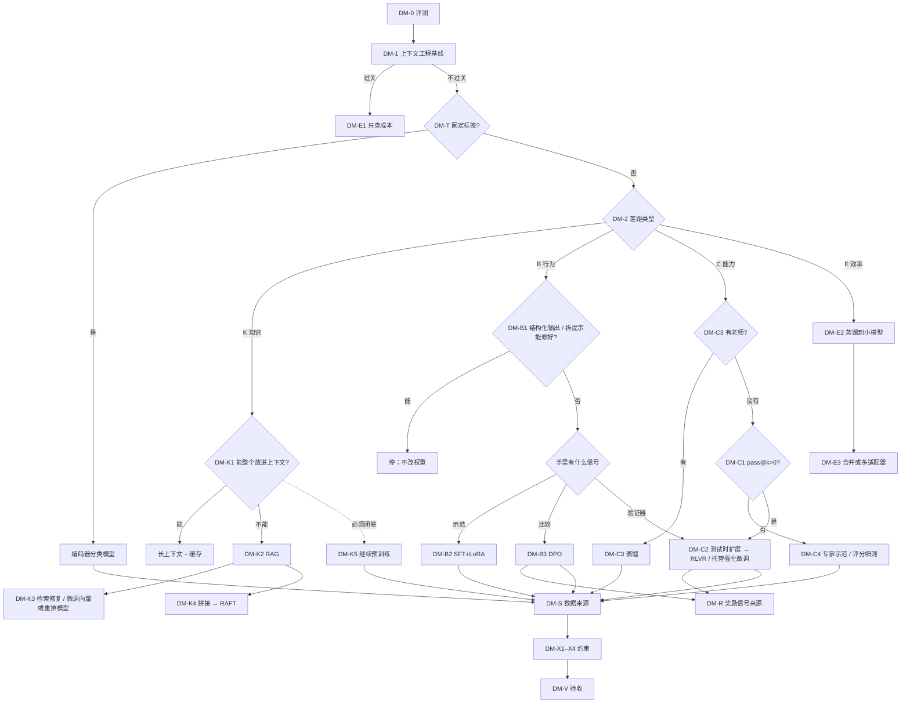

# F 部分：怎么选（全课决策图、各课"怎么选"卡片、F1 逐段规划与案例库）

2026-10-10。按 [README.md](README.md) 第 8 节模板写。

出处：
- 覆盖面和"实际最常用"以 [research-adoption.md](research-adoption.md)（简称 adoption）为准；
- 技术事实以 [research-technical.md](research-technical.md) 为准；
- RAG 部分的补充出处见 [part-a-map-rag.md](part-a-map-rag.md) 文末。

## 构建记录（2026-10-10，按实际实现更新）

- **新增 F0「中场选择练习」**（约 10 分钟，放在 B 部分之后）：只用到目前已经学过的几条路，包括上下文/RAG、编码器分类模型、SFT 和继续预训练。共五个短案例，再加一道"你自己的项目"自由作答题。
- **`decision_map` 只画到 `upto` 为止已经学过的节点**：未解锁的节点不画，也不留空框，图随课程逐课长大；完整的图只在 F1 出现。框里不显示节点编号；正文仍用 DM-K2 这样的写法。底部卡片标成"第 E1 课 / Lesson E1"，避免和节点名混淆。
- **D2 拆成 D2a、D2b 两课**：`upto` 和 `card` 都接受这两个编号；写 `D2` 时等同于 D2b。
- **F1 的结构**：两个示范案例（案例 1、案例 10）；三组课内案例题：
  - 案例 5：选择题加自由作答；
  - 案例 9：先预测，再进成本世界，最后给建议；
  - 案例 7：四问，其中有一道变式。

  之后是 7 道快速分诊题、"你的项目"自由作答，以及收在折叠块里的十一个案例的案例库。

本文件有三个用途：
1. **第 1 节 决策图**：全课统一的节点编号。各课的"怎么选"卡片都挂在这些节点上。
2. **第 2 节 各课卡片清单**：A1 到 E3 每课给决策图添加的规则和反例。其他部分的作者请按这里的节点编号写自己课末的卡片，措辞可以改。如果你的课的证据不支持某条规则，请在你的文件里注明，F1 会跟着改。
3. **第 3 节 F1 逐段规划**，第 4 节案例库。

---

## 1. 决策图（`decision_map`）

### 1.1 原则

1. **评测先行。** 没有评测集，就无从判断任何方法是否有效。从业者连续几年把评测列为头号难题（adoption 第 10 条）；OpenAI 的流程也是先写评测（[指南](https://developers.openai.com/api/docs/guides/model-optimization)）。
2. **默认不改权重。** 约 80% 的团队用提示词，约 49% 用 RAG，只有约 26% 做微调（[Notion 2026](https://www.notion.com/lp/ai-engineering-survey)，自报数据）。
3. **先分清差距是哪一类，再看手里有什么信号。** 差距分知识、行为、能力、效率四类。信号是示范、比较、验证器或评分器、老师、标签中的一种。
4. **约束每一步都要查。** 包括显存、平台能不能用、遗忘与安全、隐私与许可。
5. **每条路径都以方法专属的评测收尾。**

### 1.2 节点（编号供各课引用）

| 节点 | 问题 | 分支与规则 | 详讲的课 |
|---|---|---|---|
| **DM-0 评测** | "好"是什么？能不能在有代表性的样例上自动或半自动地打分？ | 不能 → 先建评测集：覆盖主要的输入类型，每条标上失败类型。几十条起步，这是经验做法。然后才进入下一步。 | A1、B3 |
| **DM-1 上下文工程基线** | 最强的可用模型，加上认真写的提示词、示例、工具定义和结构化输出，能不能过关？ | 能 → 停在这里，只查成本（DM-E）。不能 → 记录失败，进入 DM-T 和 DM-2。 | A1 |
| **DM-T 任务形态** | 输出是不是一组固定标签或一个分数？例如分类、路由、审核、意图识别。 | 是，并且有标签（人工标注，或者让大模型标注）→ **微调编码器分类模型**。这一步很便宜、很快；用大模型标注，就相当于把大模型蒸馏进分类器。 | A1、F1 案例 3 |
| **DM-2 差距分类** | 失败属于哪一类？ | 用"把正确资料放进上下文"做测试：放进去就对了 → **K 知识**。资料都在，但格式、风格、流程不稳 → **B 行为**。资料和指令都给了，还是做不对 → **C 能力**。质量够了，只是太贵、太慢或不能外发 → **E 效率**。 | A1 |
| **DM-K1** | 知识能不能整个放进上下文？约 20 万 token 以内，而且相对稳定。 | 能 → 全量放进提示，配合提示缓存（[Anthropic](https://www.anthropic.com/news/contextual-retrieval)）。不能 → DM-K2。 | A2 |
| **DM-K2 RAG** | 要不要引用、权限控制、经常更新？ | 用 RAG（切块、混合检索、重排）；先单独测检索的 recall@k。 | A2 |
| **DM-K3** | 召回不够怎么办？ | 依次试：切块和元数据 → 混合检索 → 重排 → 微调重排模型（不用重建索引）→ 微调向量模型（对比损失，要重建索引）。 | A2 |
| **DM-K4** | 召回够了，生成还是错？ | 先改提示的拼法（顺序、引用要求、"没有就说没有"）；仍然不行，再做 RAFT 式 SFT 生成模型（训练样本带干扰文档）。 | A2、B1 |
| **DM-K5** | 必须闭卷吗？例如离线运行、不能检索、延迟要求极低。 | 继续预训练：大量改写过的领域文本，混入通用和对话数据，之后再做 SFT。要接受幻觉风险（Gekhman）。 | A1、B2 |
| **DM-B1** | 行为问题：结构化输出、拆分提示、加示例能修好吗？ | 能 → 停在这里。 | A1、F1 案例 2 |
| **DM-B2 示范** | 能写出（或筛选出）正确示范吗？ | **SFT，默认 LoRA**。训练样本的格式必须和线上请求完全一致。 | B1、C2 |
| **DM-B3 比较** | 写不出完美回答，但能判断两个回答哪个更好吗？ | **DPO**（默认）。只有点赞、点踩这类标签 → KTO。先确认奖励信号从哪来（DM-R）。 | D1、D3、D4 |
| **DM-R 奖励信号** | 打分从哪来？ | 优先级：规则验证器 > 评分细则加大模型评委 > 训练奖励模型。任何学出来的打分器，都要先用留出的人工判断验准确率，再拿来优化。 | D1、D2、E1 |
| **DM-C1 能力起点** | 当前模型在 k 较大时能不能偶尔做对？即 pass@k 是否大于 0。 | 否 → 强化学习拿不到信号。先蒸馏或做 SFT，或者换更容易的题，按课程式安排。 | E1 |
| **DM-C2 验证器** | 能不能自动判对错，或者有可靠的评分器？ | 能： - 应用允许多次尝试 → 先试测试时扩展（best-of-N 加验证器），可能不用训练； - 否则 → **RLVR**（GRPO 类，自建）或**托管强化微调**（带评分器的服务）。通常先做冷启动 SFT。 先审查评分器会不会被钻空子。 | E1、E2 |
| **DM-C3 老师** | 有没有更强的模型可以当老师？许可证允许吗？ | 有 → **蒸馏**：合成数据加拒绝采样，再做 SFT（序列级）；之后可以做在线蒸馏，或者多老师蒸馏。小模型要获得推理能力，优先走这条路。 | B2、E2、E3 |
| **DM-C4** | 既没有验证器，也没有老师？ | 收集专家示范（→ DM-B2）或偏好比较（→ DM-B3）；或者写评分细则，用大模型评委打分，同时防奖励投机。 | D1、D2 |
| **DM-S 数据来源** | 训练数据从哪来？凡是要改权重的路径都要回答这个问题。 | 四个来源： - 人工标注或示范； - 日志和反馈，要先去掉个人信息； - 老师合成，要用验证器或评委过滤（拒绝采样）； - 自家模型多次采样，只保留通过验证的（专家迭代）。 数据质量是主要杠杆，比选哪种损失更重要（adoption "What the course list misses"第 2 条）。 | B2、D4 |
| **DM-E1 成本** | 太贵或太慢？ | 先算账（`cost_crossover`）：提示缓存、更短的提示（靠微调实现）、换更小的模型。 | A1 |
| **DM-E2 小模型** | 要更小、更快、端侧或私有部署？ | 蒸馏到小模型：序列级 → 在线蒸馏 → 多老师。部署量化是另一个决定，与 QLoRA 无关。 | E3、C3 |
| **DM-E3 上线形态** | 一个任务还是很多任务、很多租户？ | 单任务、低延迟 → 合并适配器。多任务、多租户 → 多适配器服务，不合并。同一基座上的多个专长模型 → 多老师蒸馏，或者（较轻的选项）模型合并。 | C3、E3 |
| **DM-X1 显存** | 全量、LoRA 还是 QLoRA？ | 按显存账来定（C1）：全量约 16 字节/参数，再加激活值和 logits。数据量超出适配器容量时，才考虑全量。 | C1–C3 |
| **DM-X2 平台** | 托管服务能不能用？ | 闭源 API 的微调可能已经关闭（OpenAI 2026 年起不再接受新用户）。托管服务默认提供 SFT，部分提供 DPO 和带评分器的强化微调；Tinker 只支持 LoRA（adoption 第 2、4 条）。否则用开源权重模型自己训练。 | A1、F1 |
| **DM-X3 遗忘与安全** | 改权重以后，有没有退化？ | 必须做通用能力和安全两类回归评测。正常业务数据也会削弱安全性（[Qi et al.](https://arxiv.org/abs/2310.03693)）。缓解办法：LoRA、低学习率、混入旧数据、KL 约束。 | B3 |
| **DM-X4 合规** | 隐私和许可证？ | 个人信息不能外发 → 用私有部署的开源模型。用老师模型的输出训练其他模型，要先查老师的使用条款。 | F1 |
| **DM-V 验收** | 用什么判断成败？ | 方法专属的信号（见 1.4），加上任务指标和回归评测，最后线上 A/B 测试。 | 全部 |

**超出范围（图上灰色注释）：** 多模态微调（视觉、语音）；量化感知训练（QAT）只在 C3 提一句。

### 1.3 图的形状（供 `decision_map` 和 F-F1-1 绘制）

### 1.4 方法专属的验收信号（DM-V）

| 方法 | 任务指标之外还要看 | 出处 / 详讲的课 |
|---|---|---|
| 上下文工程 | 每类失败的通过率；提示改版前后在同一评测集上对比 | A1 |
| RAG | 检索：recall@k、MRR。端到端：忠实度、正确率、"应拒答"题的拒答率 | A2 |
| 编码器分类 | 各类别的精确率、召回率，以及混淆矩阵；按时间切分的留出集，用来看分布漂移 | 标准知识 |
| SFT | 格式遵循率；通用能力和安全回归；不能只看 loss | B3（InstructGPT、LIMA：loss 和质量不一致） |
| DPO | 长度受控的胜率；chosen 的 log 概率有没有下降（似然位移）；回答长度 | D3、D4 |
| RLVR / 强化微调 | pass@1 和 pass@k；回答长度；零方差组的比例；人工抽查评分器有没有被钻空子 | E1 |
| 蒸馏 | 师生在同一评测集上的差距；成本和延迟 | E3 |
| 继续预训练 | 领域困惑度，以及指令遵循等通用评测（防止丢掉对话能力） | B2 |

### 1.5 常见陷阱（F1 第 3 段的小表）

| 陷阱 | 误区 id | 正确的节点 | 对应案例 |
|---|---|---|---|
| 用微调灌会变化的知识 | `ft-injects-knowledge` | DM-K1、DM-K2 | 1 |
| 还没试过结构化输出和拆分提示，就去微调 | `ft-is-default` | DM-B1 | 2 |
| 固定标签的任务，也用生成式大模型 | `llm-for-everything` | DM-T | 3 |
| RAG 答错，就去改生成模型 | `fix-generator-first` | DM-K3 | 4 |
| 能写示范，却直接上强化学习 | `rl-strictly-better` | DM-B2 | 5 |
| 用几乎相同的偏好对做 DPO | `dpo-raises-chosen`（D3） | DM-B3 | 6 |
| 把会变化的表结构写进权重；有验证器却去收集比较 | `ft-injects-knowledge`、`rl-strictly-better` | DM-K2、DM-C2 | 7 |
| 没有环境和成功判定，就做智能体强化学习 | `rl-strictly-better` | DM-1、DM-S | 8 |
| 以为只缩短提示就能降本 | `ft-always-cheaper` | DM-E1 | 9 |
| 小模型直接做强化学习；以为"回答越长越聪明" | `rl-strictly-better`、`longer-is-better` | DM-C3 | 10 |
| 只用少量对话 SFT，就想学会一门语言 | `few-examples-suffice`（B2） | DM-K5 | 11 |
| 奖励一路涨就继续训练 | `reward-up-means-better` | DM-R、DM-V | 课后测验 5 |
| 用 QLoRA 来降低推理成本 | `qlora-for-inference` | DM-E2 | 课后测验 6 |

误区 id 中，`qlora-for-inference` 沿用 C3，`longer-is-better` 沿用 E1/E2，`few-examples-suffice` 沿用 B2。`dpo-raises-chosen` 和 `reward-up-means-better` 是给 D 部分的建议名；D 如果用了别的 id，以 D 为准，F1 跟着改。

---

## 2. 各课的"怎么选"卡片（A1–E3，供各部分作者引用）

**格式：** 每课结尾放一页，包括四部分：
- `decision_map` 场景，解锁到本课为止的节点，高亮本课新增的节点；
- **规则**：一两句话；
- **反例**：一个"诱人但错误"的选择，附它为什么失败；
- 一道把规则用到新场景的小题，放在该课的检验题里。

| 课 | 节点 | 规则 | 反例（为什么诱人、为什么错） | 证据 |
|---|---|---|---|---|
| A1 | DM-0、DM-1、DM-T、DM-2 | 默认不微调：先写评测，用上下文工程跑出基线。剩下的失败分四类：知识放上下文，其余看手里的信号。输出是固定标签的，用编码器分类模型。 | 用 500 条 FAQ 做 SFT，让模型"记住"新产品。诱人之处在于数据现成。错在：模型学到的是口吻，事实不可靠，还会编造。 | [Gekhman](https://arxiv.org/abs/2405.05904)、[Notion 调查](https://www.notion.com/lp/ai-engineering-survey) |
| A2 | DM-K1–K4 | 答错时先单独测检索。召回不够，按"切块 → 混合检索 → 重排 → 微调重排模型或向量模型"的顺序修；召回够了，再改拼接，最后才考虑 RAFT。 | 答案错了，就去微调生成模型。诱人之处在于生成模型最显眼。错在：正确的块根本没进前 k（FP2），微调只会教模型在没有证据时自信作答。 | [Barnett](https://arxiv.org/abs/2401.05856)、[Anthropic](https://www.anthropic.com/news/contextual-retrieval) |
| B1 | DM-B1、DM-B2、DM-K4 | 要模型稳定地输出固定的格式、风格或流程，而提示词做不到或者太长 → SFT。训练和推理用同一个模板、同一个停止符；训练样本的上下文结构也要和线上一致，包括检索结果和工具定义。提示长、回答短、数据少时，试一个小的提示损失权重。 | 一条系统提示词加结构化输出就能稳定得到的 JSON 格式，也去做 SFT。错在：这是用昂贵的手段解决便宜的问题（见 F1 案例 2）。 | [TRL 文档](https://huggingface.co/docs/trl/sft_trainer)、[RAFT](https://arxiv.org/abs/2403.10131)；以 part-b-sft.md 的 B1 卡片为准 |
| B2 | DM-S、DM-C3、DM-K5 | 数据来源决定方案： - 答案能自动判对错 → 先做拒绝采样或专家迭代，再考虑强化学习； - 有老师且许可允许 → 序列级蒸馏； - 领域语言差异大且有大量文本 → 继续预训练，混入回放数据，再做 SFT； - 事实需要可追溯或经常更新 → RAG。 | 只有几百份文档，却想让模型"记住"它们。错在：这不是继续预训练或 SFT 能解决的问题，应该用 RAG。另一个反例："强模型的输出就等于强模型的能力"——合成数据换来的是格式和风格。只用领域文档做继续预训练，还会丢掉指令遵循：IF-eval 从 79% 掉到 45%。 | research-technical 第 7 节；adoption"What the course list misses"第 2 条；以 part-b-sft.md 的 B2 卡片为准 |
| B3 | DM-0、DM-V、DM-X3 | 先写评测再训练：没有任务留出集和回归集，就不开始。选检查点看任务指标和回归门槛，不看 loss，并报告置信区间。新旧能力都要保住 → 回放约三成通用数据，配较小的学习率。 | "新模型在 100 道题上高 2 分，所以上线。"错在：这个差距在噪声范围之内。"数据都是干净的，不用测安全。"错在：正常数据也会削弱安全性。 | [Qi et al.](https://arxiv.org/abs/2310.03693)；以 part-b-sft.md 的 B3 卡片为准 |
| C1 | DM-X1 | 先算账，再租卡：全量约需 16 字节 × N，再加激活值。不够就依次考虑 LoRA → QLoRA → 多卡分片或卸载。长上下文或大 batch 时，大头是激活值和 logits，先开激活重算和融合交叉熵。 | "我的卡能装下模型做推理，就能装下训练。"错在：训练还要梯度、优化器状态和激活值；8B 全量微调约需 135–150 GB。"序列 32k 显存不够，所以换 QLoRA。"错在：QLoRA 只省下约 10 GB 权重，logits 和激活值仍有几十 GB。 | research-technical 第 3 节；以 part-c-efficiency.md 的 C1 卡片为准 |
| C2 | DM-X1、DM-B2 | 中小规模的 SFT 和各种强化学习 → 默认 LoRA：加在所有线性层，学习率约为全量的 10 倍，小 batch。数据量很大（百万条，或数十亿 token 的继续预训练），而且要求目标领域的最高表现 → 全量或很大的秩。在意不弄坏原有能力 → LoRA 本身就是一种正则。 | "为了让推理更小更快而用 LoRA。"错在：合并后模型一样大。"只挂注意力层，把秩开大来补。"错在：参数量相同时效果也更差。 | [Biderman](https://arxiv.org/abs/2405.09673)、[LoRA Without Regret](https://thinkingmachines.ai/blog/lora/)；以 part-c-efficiency.md 的 C2 卡片为准 |
| C3 | DM-E2、DM-E3、DM-X1 | 训练显存不够 → LoRA，还不够 → QLoRA。多租户、多任务 → 共享基座加多适配器服务；单一产品、高并发 → 合并，合并 QLoRA 适配器后要重新评测。推理要省显存 → PTQ（GPTQ、AWQ 等）或 QAT。 | "用 QLoRA 训练，上线的模型也就是 4 位、很省。"错在：合并到 bf16 后就是 bf16 的大小。"200 个客户就部署 200 份模型。"错在：适配器只有几十 MB，可以共享基座。 | research-technical 第 4 节；adoption 第 9 条；以 part-c-efficiency.md 的 C3 卡片为准 |
| D1 | DM-R、DM-B3 | 先确定奖励信号从哪来：能用规则验证就用验证器，其次是评分细则加大模型评委，最后才训练奖励模型。任何学来的打分器，先用留出的人工判断验准确率。 | 拿一个没校验过的大模型评委直接打分来优化。错在：它可能偏爱更长的回答，优化出来的是冗长。只用长度做奖励，就能复现 RLHF 的大部分提升。 | [Singhal et al.](https://arxiv.org/abs/2310.03716)；CS224N（"先确认奖励模型是对的"） |
| D2 | DM-R、DM-C4 | 用学来的奖励做强化学习，必须有 KL 约束或早停，并用独立的真实评测决定停在哪。PPO 用来理解原理；实践中用 GRPO 类方法或 DPO。 | 代理奖励一路涨，就一直训练下去。错在：真实质量随 KL 增大先升后降。 | [Gao et al.](https://arxiv.org/abs/2210.10760) |
| D3 | DM-B3 | 有离线的成对偏好，又不想维护奖励模型和在线采样 → DPO。β 决定能离参考模型多远。训练时同时监控 chosen 的 log 概率。 | 用两个回答几乎一样的偏好对训练"拒答"。错在：发生似然位移，拒答率反而从 74.4% 降到 33.4%。 | [Razin et al., ICLR'25](https://arxiv.org/abs/2410.08847) |
| D4 | DM-B3、DM-S | 默认用 DPO，只在数据形态要求时换变体（只有点赞点踩 → KTO）。偏好对的质量比变体更重要：可以用"强模型的回答 vs 弱模型的回答"构造成对数据（差值学习），也可以在线采样后再标注。 | "有了更好的回答，直接 SFT 就行。"错在：Olmo 3 发现，用同样的 chosen 回答做 SFT 反而有害；用"强 vs 弱"成对做 DPO 才有效。 | [Olmo 3](https://arxiv.org/abs/2512.13961)；adoption 第 5 条（变体在实践中很少见） |
| E1 | DM-C1、DM-C2、DM-R | 结果能被程序判定，并且模型在 G 次采样里能偶尔做对 → RLVR（GRPO 一系）或托管强化微调，不必训练奖励模型。评分器上线前先过三关：和人工判分的一致率、对抗回答测试、留一个训练时不用的金标准评测。托管还是自建：用闭源模型或没有 RL 工程能力 → 托管；要开源权重或完全控制 → 自建。 | 题目对当前模型太难：全错的组占多数，没有学习信号。奖励只能靠主观判断时，硬写一条规则当奖励，只会被模型钻空子。 | [DeepSeekMath](https://arxiv.org/abs/2402.03300)、[DAPO](https://arxiv.org/abs/2503.14476)；以 part-e-reasoning.md 的 E1 卡片为准 |
| E2 | DM-C2、DM-C3 | 推理模型的默认顺序：先做 SFT（冷启动或蒸馏）→ RLVR →（可选）拒绝采样后再 SFT → 再一轮强化学习；小模型先考虑蒸馏。应用允许多次尝试、又有验证器时，先试测试时扩展（best-of-N），可能根本不用训练。奖励默认用结果奖励加评分细则。 | 基座在大 k 时的 pass@k 也约等于 0，却直接上强化学习。32B 模型直接做强化学习，AIME 只有 47.0，而蒸馏得到 72.6。训练奖励在涨、留出集不涨时，先查评分器，不要急着换算法。 | [R1](https://arxiv.org/abs/2501.12948)、[Dr. GRPO](https://arxiv.org/abs/2503.20783)；以 part-e-reasoning.md 的 E2 卡片为准 |
| E3 | DM-E2、DM-C3、DM-E3 | 手里有更强的老师，小模型优先蒸馏，不要直接做强化学习。 选哪种蒸馏，看能拿到老师的什么： - 只有文本（API）→ 序列级蒸馏，先查服务条款； - 能本地跑、分词器相同 → 先序列级 SFT 热身，再在线蒸馏（Qwen3 的顺序）； - 分词器不同 → 序列级，或实验性的 GOLD/ULD 跨分词器蒸馏（只是近似）。 多个专家合成一个 → 多老师在线蒸馏；权重合并只用于同一基座、零训练成本先试一下。 担心遗忘 → 选在线方法，或用旧模型当老师做一次在线蒸馏。 | 老师在你的领域本身就不行：蒸馏的上限就是老师。不同基座的模型做权重合并：坐标不对应。需要多样输出的任务（如创作）只用反向 KL 在线蒸馏：多样性下降。 | [在线蒸馏](https://thinkingmachines.ai/blog/on-policy-distillation/)、[Qwen3](https://arxiv.org/pdf/2505.09388)、research-technical 第 7 节；以 part-e-reasoning.md 的 E3 卡片（E3-1 至 E3-4，反例 E3-a 至 E3-c）为准 |

**说明：** B、C、D、E 四部分已经写好各自的卡片。上表 B1–B3、C1–C3、E1–E3 是按它们的卡片摘要并挂上节点编号的，措辞以各自的文件为准；D 部分沿用了上表 D1–D4 的建议稿，各自又补了一条（见 part-d-preference.md）。D2 后来拆成两课：`d2a`「从策略梯度到 PPO」和 `d2b`「KL 约束下的最优策略与 RLHF」；上表 D2 一行对应 d2b，`decision_map` 的 `upto` 和 `card` 也接受 `D2a`、`D2b`。

**给各课作者的约定：**
1. 卡片的规则要能直接操作，写成"如果……就……"，不要写"要注意……"。
2. 反例要是真实发生过的，或者有证据支持的，并附出处。
3. 课末检验题里，至少有一道题要用到这张卡片。
4. 场景调用 `decision_map` 时传入 `{ upto: '<课号>', highlight: [<本课节点>] }`。

---

## 3. F1 决策框架与案例研讨

- **时长：** 约 35 分钟核心内容，另有案例库供课后练习和课后测验使用
- **前置：** A1–E3。也可以学完 A、B 就先做一个简化版，只用 K、B、T 三条分支的案例。
- **技能 id：**
  - `f1-route`：从需求推到路径
  - `f1-trap`：认出诱人的错误选择
  - `f1-data`：数据方案
  - `f1-risk`：风险
  - `f1-eval`：验收方案
- **误区 id：** 全课误区的综合检验，重点是下面几个：
  - `ft-is-default`
  - `ft-injects-knowledge`
  - `llm-for-everything`
  - `fix-generator-first`
  - `rl-strictly-better`
  - `reward-up-means-better`
  - `qlora-for-inference`
  - `longer-is-better`（E1/E2）

### 学完能做到（可检验）

1. 给一个没见过的需求，沿决策图写出路径，例如"DM-0 → DM-1 → DM-2: K → DM-K2 → DM-K3"，并说明每一步的判断依据。（案例题第 1 问）
2. 指出这个场景下最诱人的错误选择，并用一条证据说明它为什么会失败。（第 2 问）
3. 写出可行的数据方案：来源、数量级、质量控制。（第 3 问）
4. 写出至少两条具体风险，以及上线前的验收方案：任务指标、方法专属信号、回归评测。（第 4、5 问）
5. 某个条件改变时（没有验证器、没有老师、请求量降低 100 倍、数据不能外发），说出路径会怎样变化。（变式题）

### 要解开的误解

F1 不引入新的误解，而是检验前面各课的误解有没有在综合情境中解开。

研究依据：
- 学生在新情境里，常常退回到"按熟悉度选方法"，例如一律微调，或者一律强化学习。research-pedagogy 第 3 节第 9 条指出，Huyen 的阶梯只是启发式，不是定律。
- 因此每个案例都设一个"诱人选项"，专门对应一个误区 id。

### 段落脚本

| # | 页面类型 | 内容要点 | 为什么用这种形式 | 分钟 |
|---|---|---|---|---|
| 1 | read + figure | **为什么"选择"是最重要的能力**： - 先看实际使用程度（F-F1-2）：大多数团队停在上下文工程和 RAG。 - 方法会过时，判断的框架不会。2023 年流行 PPO；2025 年以后实践中用 GRPO 类和 DPO（adoption 第 9 条）。 - 五条原则（见 1.1）。 - 说明本课怎么判分：每个案例按五个维度评分（见下方评分细则）。 | 先给框架和评分标准，学生知道要练什么。 | 2 |
| 2 | scene | **决策图总装**（`decision_map`，`upto: 'F1'`）：A1–E3 的 15 张卡片依次飞到各自的节点上，最后停在完整的决策图上。 | 一次性把全课串起来；卡片和节点的对应关系用动画看最清楚。只看，不操作。 | 2.5 |
| 3 | read | **决策图的文字版**：节点表（1.2）、验收信号表（1.4）、"常见陷阱"小表（每个陷阱对应一个误区 id 和一个案例）。可以折叠，也可以打印。 | 这是供查阅的材料，后面的案例都要回来查。 | 3 |
| 4 | read | **示范案例一：内部政策助手**（案例 1，不微调）。逐步标出决策图路径；诱人选项是 SFT，说明为什么错。 | 先完整示范一次怎么推理：先看示范，再自己做。 | 2.5 |
| 5 | read | **示范案例二：7B 数学推理**（案例 10，蒸馏还是强化学习）。用 pass@k 判断能不能用强化学习；用 R1-Distill 的数据说明为什么小模型先蒸馏。 | 第二个示范放在能力分支，证据最硬。 | 2.5 |
| 6 | checkpoint（案例题） | **案例 5：客服风格与流程。** - 第 1 问：选路径（单选）； - 第 2 问：选诱人的错误（单选）； - 第 3–5 问：数据、风险、评测（自由作答，AI 按细则判读）。 | 综合检验，开放的部分需要 AI 判读。 | 5 |
| 7 | checkpoint（预测）+ world | **案例 9：通话摘要降本。** - 先预测：每天 30 万通，以及每天 3,000 通时，蒸馏到小模型并私有部署，能不能回本？ - 再进 `cost_crossover`，参数换成本案例的数值（见案例 9）。 | 复用 A1 的世界，用真实的预算检验"降本"类决策。三条准则的论证同 A1。 | 3.5 |
| 8 | checkpoint（案例题） | **案例 7：Text-to-SQL。** 四问，外加一道变式："如果没有可以执行查询的测试库呢？" | 能力分支，同时涉及评分器设计和托管强化微调。 | 4 |
| 9 | checkpoint（快速分诊） | 六个短案例（案例 2、3、4、6、8、11）。每个两问：走哪条路径、哪个是诱人的错误。都是单选。 | 增加练习的数量和覆盖面。单选题即时反馈，每题都关联误区 id。 | 4.5 |
| 10 | ask | **把你自己的项目走一遍决策图。** - AI 导师按 DM-0 → DM-V 逐个节点提问； - 最后按五个维度给出评分和建议； - 可以调用 `decision_map` 高亮学生的路径。 | 迁移到学生自己的项目，必须因人而异。 | 3 |
| 11 | read | **案例库**（第 4 节全部 11 个案例的完整解析），课后练习和课后测验从这里抽题。 | 不计入课时；供复习用。 | — |

**本课不新增交互。**
- 原因：决策本身是离散判断，用案例题检验比任何拖动操作都直接。
- 唯一的世界是复用 A1 的 `cost_crossover`，用于案例 9。它满足三条准则：
  1. 持平点由多个真实的预算量共同决定；
  2. 每个滑块就是一项预算输入；
  3. 先预测，最后回答"在什么请求量以下不该蒸馏"。

### 交互规格

**W-F1-1 `cost_crossover`（复用，案例 9 的参数）**

- **参数：**
  - 方案 A（大模型 + 长提示）：
    - `tokens_in_a` = 2,500（通话转写平均长度加指令）；
    - `price_in_a` 和 `price_out_a` 沿用 A1 的示例价；
  - 方案 B（私有部署的蒸馏小模型）：
    - `tokens_in_b` = 2,300（转写本身省不掉，只省下指令部分）；
    - `price_in_b`、`price_out_b` = 0（自建，按固定成本计）；
    - `fixed_per_day` = 100，代表一台推理服务器的日租金加上训练费摊销（示例值）；
  - `tokens_out` = 200。
- **要注意到什么：**
  - 这里缩短提示几乎省不了钱，因为转写本身就很长；
  - 省钱靠的是"按固定成本自建小模型，替换掉按 token 计费"；
  - 请求量低时，固定成本吃掉全部收益。
- **算例（示例价）：** $c_A = 2500\times3/10^6 + 200\times15/10^6 = 0.0105$ 美元，$c_B = 0$，所以 $N^* = 100/0.0105 \approx 9{,}500$ 通/天。
  - 每天 30 万通时，A 约 3,150 美元/天，B 约 100 美元/天；
  - 每天 3,000 通时，A 约 31.5 美元/天，比 B 便宜。
- **模型没有覆盖的部分（用文字说明）：** 固定成本假设一台服务器扛得住这个请求量；请求量再大，就要按台数增加固定成本。零件里不模拟这一点。
- **结束时的问题：** "每天 3,000 通时，你会怎么建议？"答案要点：不值得自建。用 API 加提示缓存；如果数据不能外发，就选更小的托管模型或私有部署，那是合规问题，不是成本问题。
- **标注：** 精确计算，价格为示例。

### 推导全文

本课没有新推导；成本公式见 A1。

### 代码片段清单

| 编号 | 展示什么 | 库 | 行数 |
|---|---|---|---|
| K-F1-1 | **验收方案模板**（YAML）。字段：任务指标、方法专属信号、回归集、安全集、上线门槛、A/B 方案。每个案例的"怎么评测"都可以照这个填。 | 无（配置文本） | 约 25 |
| K-F1-2 | **案例作答模板**（Markdown）。五段：路径、诱人错误、数据、风险、评测。与评分细则一一对应。 | 无 | 约 15 |

### 图片清单

| 编号 | 画什么 | 依据 | 类型 |
|---|---|---|---|
| F-F1-1 | 完整决策图（1.3 的形状），每个节点旁标出详讲的课号 | 本文件第 1 节 | `decision_map` 最终帧 / SVG |
| F-F1-2 | "方法的实际使用程度"条形图：团队调查，以及 Hub 上 TRL 自动打的标签数：trl+sft 78,127、trl+grpo 14,257、trl+dpo 10,532；另有用 Trainer 训练的文本分类模型 43,372 个。图注说明 Hub 数量偏向业余上传，调查是自报 | [research-adoption.md](research-adoption.md) | 重绘 |
| F-F1-3 | 每个示范案例一张路径图：在决策图上高亮这个案例走过的节点 | 案例 1、10 | `decision_map` 参数化 |

### 检验题与评分细则

**案例题评分细则（AI 导师判读，每维 0–2 分，满分 10 分）**

| 维度 | 2 分 | 1 分 | 0 分 |
|---|---|---|---|
| R1 差距分类 | 类别正确（K、B、C、E 或固定标签），并给出判断依据，例如"放进正确资料后答对了" | 类别正确，但没有依据 | 类别错误 |
| R2 方法与信号 | 方法和手里的信号匹配；先试过更便宜的做法（上下文工程），或者说明了为什么跳过 | 方法可行，但跳过了更便宜的一步 | 方法与信号不匹配，例如"只有答案却做 SFT" |
| R3 数据 | 写出来源、数量级和质量控制（过滤、去除个人信息、按文档或时间切分） | 只写了来源 | 没写，或不可行 |
| R4 风险 | 至少两条具体风险，各有缓解办法 | 只有一条，或风险太泛，例如"可能过拟合" | 没写 |
| R5 评测 | 任务指标、方法专属信号（见 1.4）、回归或安全，三者都有 | 只有任务指标 | 没写 |

- **通过：** 总分 ≥ 7，并且 R5 ≥ 1。
- **为什么 R5 单独设门槛：** 评测是从业者的头号难题（adoption 第 10 条）。

**课内题目（题面和答案，案例内容见第 4 节）：**

*案例 5（第 6 段）*
- **Q1 路径（单选）：**
  - A. 继续往系统提示词里加规则
  - B. 用精选对话做 SFT（LoRA），训练样本带上线上同样的系统提示词和工具定义 ✔
  - C. 先训练奖励模型，再做 PPO
  - D. 把品牌手册放进 RAG
- **Q2 诱人的错误（单选）：** "下面哪个最诱人、但最不该先做？"
  - 答案：C。
  - 反馈："你手里已经有示范了，比较和奖励是更弱、更贵的信号（A1 的'信号决定方法'）。"
  - 选 A 的反馈：A 是上一步已经试过的做法；提示越来越长，成本和延迟都在涨，长对话里的规则照样会被忽略。
- **Q3–Q5（自由作答）：** 按评分细则 R3–R5 判读，要点见案例 5 的"AI 判读要点"。

*案例 7（第 8 段）*
- **Q1：** 表结构该放哪？→ 上下文，用 RAG 检索（误区 `ft-injects-knowledge`）。
- **Q2：** 动手训练之前先测什么？→ pass@k 是否明显高于 pass@1（DM-C1）。
- **Q3：** 评分器怎么写？→ 在只读测试库上执行 SQL，比较结果集，并加非空断言。干扰项"只比对 SQL 字符串"会把等价的写法判错。
- **Q4：** 自建还是托管？→ 两者都可以，看平台和工程能力（DM-X2、E1 卡片）。
- **变式（自由作答）：** 没有测试库怎么办？要点：没有验证器 → 专家写标准 SQL 做 SFT；如果用大模型评委，先在人工标注上校准。

*快速分诊（第 9 段）*
- 每个案例两道单选：
  - 路径：四个选项，分别对应不同的决策图节点；
  - 诱人的错误：四个选项，其中一个就是案例里写的"诱人的错误"。
- 正确答案就是各案例的"推荐路径"和"诱人的错误"。每个错误选项都标上对应的误区 id（见 1.5）。

**课后测验中"选择"类的题目**（并入全课约 20 题的概念测验，课前、课后各做一次）：

1. 内部知识每周更新，需要附带引用。第一选择是？
   - 答案：RAG（不是 SFT）
   - 误区：`ft-injects-knowledge`
2. 把客服工单分到 15 个类别，已有 3 万条标注。第一选择是？
   - 答案：编码器分类模型（不是给生成式大模型做 SFT）
   - 误区：`llm-for-everything`
3. RAG 答错了；检查发现，正确的块排在第 40 位。第一步做什么？
   - 答案：重排，或者混合检索（不是微调生成模型）
   - 误区：`fix-generator-first`
4. 想让 7B 模型学会解竞赛题，手里有 R1 级别的老师。第一选择是？
   - 答案：蒸馏老师的推理轨迹（不是直接做 GRPO）
   - 误区：`rl-strictly-better`
5. 强化学习训练中，奖励模型的分数一路上涨。该怎么做？
   - 答案：用独立评测判断停在哪，并加 KL 约束（不是继续训练）
   - 误区：`reward-up-means-better`
6. 想降低线上推理的成本。下面哪个说法是错的？
   - 错误说法："改用 QLoRA 训练，就能降低推理成本"
   - 误区：`qlora-for-inference`

### "怎么选"卡片（F1）

F1 不新增节点，卡片就是完整的决策图（F-F1-1）加上五条原则（1.1）。

### 中英术语（本课新出现）

- 决策图（decision map）
- 案例研讨（case study）
- 评分细则（rubric）
- 验收标准（acceptance criteria）
- 分诊（triage）
- 多适配器服务（multi-LoRA serving）
- 私有部署（on-premises / self-hosted deployment）
- 回归评测（regression eval）
- A/B 测试（A/B test）

---

## 4. 案例库

每个案例的固定结构：
- 需求
- 诱人的错误（附它为什么失败）
- 推荐路径（写出决策图节点）
- 数据
- 风险
- 怎么评测
- 变式

数字凡是没有标出处的，都是为案例虚构的设定，在课程里要标注"设定"。

### 案例 1 内部政策助手（不微调）· 示范案例
- **需求：** 3,000 名员工询问人事和 IT 政策。政策文档约 800 篇，每周都有改动。回答要附出处；部分文档只对经理可见。
- **诱人的错误：** 把政策整理成问答对，然后做 SFT。
  - 知识每周都在变，写进权重就要每周重新训练；
  - 新事实学得慢，学会了还会推高幻觉（Gekhman）；
  - 写进权重后，没法按权限控制谁能看到什么。
- **推荐路径：** DM-0 → DM-1 → DM-2: K → DM-K1（800 篇放不进上下文）→ DM-K2 RAG → DM-K3（按需要）。
  - 检索时按用户权限过滤；
  - 块的元数据带上生效日期，冲突时取最新版本；
  - 提示里规定"没有就说没有"，并按编号引用。
- **数据：**
  - 200 条真实问题，标注到相关块的 id；
  - 30 条"文档里没有答案"的问题。
- **风险：**
  - 过时版本被检索出来（FP4）；
  - 越权泄露；
  - 文档里藏着间接提示注入。
- **怎么评测：**
  - recall@10；
  - 忠实度（抽查引用是否支持回答）；
  - "应拒答"题的拒答率；
  - 越权测试：用普通员工的身份去问只有经理可见的内容。
- **变式：** 如果政策只有 30 篇，总共约 5 万 token？→ DM-K1：整体放进提示，加缓存，连检索都可以省掉。

### 案例 2 合同字段抽取，格式不稳（不微调）
- **需求：** 从合同里抽出 20 个字段，输出 JSON。目前用大模型加提示词，约 3% 的输出 JSON 不合法，还经常漏掉"违约金"字段。
- **诱人的错误：** 收集 2,000 条样本做 SFT。这么做不是不行，但在用上结构化输出之前就微调，是在用昂贵的手段解决便宜的问题。
- **推荐路径：** DM-0 → DM-1 → DM-B1：
  - JSON 不合法 → 用结构化输出或约束解码，按 JSON Schema 强制格式（主流 API 和 vLLM 都支持，属于标准知识）；
  - 漏字段 → 把提示拆成两步：先定位条款，再抽字段；并给"违约金"加两个示例。
  - 评测之后仍然不行 → DM-B2 SFT。
- **数据：** 100 份人工标注的合同作为评测集，按字段标注。
- **风险：**
  - 约束解码能保证格式，保证不了内容对不对；
  - 合同类型变了，提示要跟着更新。
- **怎么评测：**
  - 逐字段的精确率和召回率；
  - JSON 合法率；
  - 按合同类型分组报告。
- **变式：** 如果每天要处理 50 万份？→ 转到案例 9 的成本逻辑：考虑蒸馏到小模型。

### 案例 3 工单分类与路由（编码器分类模型）
- **需求：** 每天 50 万条工单，分到 15 个处理队列。已有 3 万条历史工单，带人工分配的队列标签。要求延迟低于 50 ms。
- **诱人的错误：** 给一个 7B 生成式模型做 SFT，让它输出队列名；或者每条都调用大模型 API。
  - 输出只是 15 个标签之一，不需要生成；
  - 成本和延迟都高出几个数量级。
- **推荐路径：** DM-1（先用大模型加提示词测出上限，同时检查历史标签的质量）→ DM-T → 微调编码器分类模型（BERT 类加分类头）。
  - 标签不够、或者质量差的类别：让大模型给一部分样本打标签，人工抽查后加进训练集。这相当于把大模型蒸馏进分类器。
- **数据：**
  - 3 万条历史标签，先清洗：同一类工单被分到不同队列的，要合并或纠正；
  - 按时间切分：最近一个月的数据只用作留出集。
- **风险：**
  - 队列调整后，类别就变了，要重新训练；
  - 长尾类别样本太少；
  - 分布漂移。
- **怎么评测：**
  - 各类别的精确率和召回率，以及混淆矩阵；
  - 和"大模型加提示词"的上限比较；
  - 上线后监控各队列的转派率。
- **变式：** 如果类别每周都在变？→ 生成式大模型加提示词，在提示里列出当前类别。灵活性的价值超过了它的成本。

### 案例 4 医疗文献检索召回差（微调向量模型和重排模型）
- **需求：** 医生用缩写提问（"PCI 术后 DAPT 疗程"），文献里写的是全称。RAG 的 recall@20 只有 50%，正确文献常常排在 200 名以外。
- **诱人的错误：** 换更大的生成模型，或者去微调生成模型。
  - 问题出在第一阶段的召回（FP2）；
  - 生成模型看不到没有被检索出来的文献。
- **推荐路径：** DM-K2 → DM-K3：
  1. 加 BM25 做混合检索，加查询改写（缩写扩展）；
  2. 如果仍然排在前 200 以外，就用 MNRL 微调向量模型。数据：从医生的检索日志和合成查询里得到（查询，相关段落）对；难负例用 `mine_hard_negatives` 挖，并设置 `relative_margin` 过滤假负例；
  3. 再微调交叉编码器重排模型；
  4. 重建索引。
- **数据：**
  - 合成查询：用大模型为每个段落写 3 个医生口吻的问题，抽样请人复核；
  - 训练集和评测集按文献划分，避免泄漏。
- **风险：**
  - 假负例；
  - 合成查询的风格和真实提问不一致；
  - 重建索引的成本；
  - 在通用查询上退步。
- **怎么评测：**
  - 留出的真实医生查询：recall@20 和 nDCG@10，在微调前后对比；
  - 一组通用查询作为回归集；
  - 端到端的忠实度。
- **证据：**
  - 这条路在实践中常见：Hub 上有约 8,000 个用 sentence-transformers Trainer 训练的模型；Databricks 报告合成数据带来提升（adoption 第 5 条）；
  - 机制见 A2 的推导。

### 案例 5 客服回复风格与流程（SFT + LoRA，必要时加 DPO）· 课内案例题
- **需求：** 电商客服要求统一的品牌语气和固定的回复结构：先共情 → 再给方案 → 最后确认。退款要调用 `refund(order_id, reason)`，参数格式必须正确。
  - 认真写过的系统提示词加示例，在评测上达到 80% 合格。
  - 剩下的失败集中在：长对话里语气走样，以及多轮之后调用参数出错。
- **诱人的错误：**
  - (a) 直接上强化学习或 RLHF。手里有现成的示范，比较和奖励都是更弱、更贵的信号。
  - (b) 继续往提示词里加规则。提示越来越长，成本和延迟随之上升，长对话里的规则也照样会被忽略。
- **推荐路径：** DM-1（80% 合格，失败已归类）→ DM-2: B → DM-B2：
  - 用 1,000–3,000 条精选对话做 SFT，用 LoRA。数量级参考 LIMA 的约 1,000 条，属于经验区间；
  - 只在客服的回复上计算损失；
  - 训练样本带上和线上完全相同的系统提示词和工具定义（B1 卡片）；
  - 如果剩下的问题是"哪种说法更得体"，而这很难写成示范 → DM-B3 DPO。
- **数据：**
  - 历史对话，先去除个人信息，挑出高评分的；
  - 用大模型按品牌风格改写，人工抽查。这是合成数据加过滤（B2）；
  - 工具调用的样本要在沙盒里执行一遍，确认可用。
- **风险：**
  - 背下个人信息；
  - 过拟合到固定措辞；
  - 安全性下降（Qi et al.），需要做安全回归；
  - 品牌语气调整后要重新训练。
- **怎么评测：**
  - 按评分细则，由大模型评委打分，并在人工标注的子集上校准评委；
  - 工具调用的参数合法率；
  - 通用和安全回归；
  - 线上 A/B：转人工率、用户满意度。
- **AI 判读要点：**
  - R2 必须提到"先有提示词基线"和"示范 → SFT"；
  - R3 要提到去除个人信息，以及工具调用经过验证；
  - R5 要提到安全回归。

### 案例 6 拒答校准（DPO，并防似然位移）
- **需求：** 健康咨询助手对正常的用药问题过度拒答，比如拒绝回答"布洛芬和对乙酰氨基酚能不能交替吃"；对真正危险的请求又偶尔放行。
- **诱人的错误：**
  - (a) 加 SFT 拒答示例。这会让过度拒答更严重。
  - (b) 用"拒答 vs 几乎相同但不拒答"的偏好对做 DPO。两个回答几乎一样，容易发生似然位移：已有研究里，拒答率从 74.4% 掉到 33.4%（[Razin et al.](https://arxiv.org/abs/2410.08847)）。
- **推荐路径：** DM-B3 → DM-R → DPO：
  - 构造边界上的对比样本：同一类问题，分出可以回答的版本和应该拒答的版本；
  - 偏好对要在语义上明显不同，用 CHES 一类的相似度指标过滤掉太像的对；
  - 训练时监控 chosen 的 log 概率。
- **数据：**
  - 两组边界提示，各数百条：一组是正常但敏感的问题，一组是真正有害的请求；
  - 偏好由医学顾问判断。
- **风险：**
  - 似然位移；
  - 只顾一个方向（只减少过度拒答，放行了危险请求）；
  - 长度偏差。
- **怎么评测：**
  - 两张表同时看：正常问题的误拒率，和有害请求的放行率；
  - 长度受控的胜率；
  - chosen 和 rejected 的 log 概率曲线。

### 案例 7 Text-to-SQL（RAG 提供表结构 + 拒绝采样 SFT + 托管强化微调）· 课内案例题
- **需求：** 分析师用自然语言查询公司的数据仓库：400 张表，表结构每月都有变化。目前大模型生成的 SQL，执行正确率是 55%。
- **诱人的错误：**
  - (a) 把表结构写进权重，也就是用表结构文档做 SFT。表结构是会变化的知识，应该放进上下文（DM-K）。
  - (b) 请人两两比较 SQL，然后做 DPO。有可以执行的验证器时，比较是更弱、更贵的信号。
- **推荐路径：**
  1. DM-K2：先用 RAG 检索相关的表结构；
  2. DM-C1：测 pass@8。如果明显高于 pass@1，说明模型能做对，只是不稳定；
  3. DM-S：用拒绝采样做 SFT：每题采样多次，只保留执行结果和标准答案一致的 SQL；
  4. DM-C2：自建 RLVR（GRPO 类），或者用托管强化微调。Azure、Bedrock、Fireworks 都提供带评分器的服务（adoption 第 4 条）。评分器在只读测试库上执行 SQL，比较结果集。
- **数据：**
  - 2,000 道题（问题加标准 SQL），来自历史查询日志；
  - 测试库要有足够的数据，覆盖边界情况，使得错误的 SQL 返回的结果不同。
- **风险：**
  - 评分器被钻空子：测试库里某张表为空时，错误的 SQL 也能返回"相同"的空结果，所以要加非空断言；
  - 表结构变化以后，训练分布失效；
  - 写操作的安全：只读账号，加语句白名单。
- **怎么评测：**
  - 留出题上的执行正确率，包括 pass@1 和 pass@k；
  - 按难度和涉及的表数分组；
  - 人工抽查评分器是否把错误判成了正确；
  - 回答长度和零方差组的比例（E1）。
- **变式：** 没有可执行的测试库？→ 没有验证器（DM-C4）。退回到"示范加评分细则"：专家写标准 SQL，做 SFT；可以用大模型评委比较 SQL 的语义，但要先在人工标注上校准。

### 案例 8 工具调用智能体（上下文工程 → 轨迹 SFT → 智能体强化学习）
- **需求：** 内部运维助手能调用 40 个内部 API，比如查日志、重启服务、开工单。一个任务平均需要 4–8 步。
- **诱人的错误：**
  - (a) 一开始就做智能体强化学习。没有可复现的环境和成功判定，就没有奖励。
  - (b) 把 40 个工具的说明全部塞进提示。描述太长，选工具时容易混淆。
- **推荐路径：**
  1. DM-1：用函数调用格式写好工具定义，并按任务检索相关工具（相当于对工具做 RAG），先测基线；
  2. DM-S：在沙盒里让强模型执行任务，只保留成功的轨迹（拒绝采样），对它们做 SFT（DM-B2）；
  3. DM-C2：可复现的沙盒加上任务成功判定，可以做智能体强化学习。实验室里有 Kimi K2、GLM-5 这样的做法（adoption 第 7 条），在企业里仍属进阶选项。
- **数据：**
  - 300 个任务模板，每个都在沙盒里有可以检查的成功条件；
  - 轨迹来自强模型。
- **风险：**
  - 训练或评测时真的执行了有副作用的操作，所以必须隔离沙盒；
  - 工具的接口变了；
  - 危险操作没经确认就执行，需要人工确认，并写安全评测。
- **怎么评测：**
  - 沙盒中的任务成功率；
  - 无效调用率；
  - 平均步数；
  - 危险操作的拦截率；
  - 通用能力回归。

### 案例 9 呼叫中心通话摘要降本（蒸馏到私有部署的小模型）· 课内世界
- **需求：** 每天 30 万通电话，每通生成一份摘要。目前用大模型 API，成本太高。合规部门也希望通话转写不要外发。
- **诱人的错误：**
  - (a) 对小模型直接做强化学习。没有老师现成的输出可学，也没有简单的验证器。
  - (b) 只把提示词缩短。转写本身就占了大部分输入 token（世界里能看到），缩短提示省不了多少。
- **推荐路径：** DM-E1（算账）→ DM-X4（不能外发）→ DM-E2 蒸馏：
  - 老师模型（如果数据不能外发，就用私有部署的大开源模型）先生成摘要，再按评分细则由评委过滤（拒绝采样）；
  - 用这些摘要对小模型做 SFT，用 LoRA；
  - 可选：在线蒸馏。学生自己生成，老师逐 token 打分；Qwen3 和 Thinking Machines 报告这样做的算力约为强化学习的 1/10（adoption 第 3 条、research-technical 第 7 节）。
- **数据：** 2 万通转写，配上过滤后的老师摘要；另外 300 通请人工写摘要，作为评测集。
- **风险：**
  - 继承老师的错误；
  - 摘要里出现转写中没有的内容（幻觉）；
  - 老师模型的许可证；
  - 业务术语变化。
- **怎么评测：**
  - 人工评分细则：覆盖关键信息、没有编造；
  - 和老师模型的差距；
  - 每条的成本和延迟；
  - 抽样核对事实。
- **世界里的问题：** 每天 3,000 通时还值得吗？答案：不值得，见 W-F1-1。

### 案例 10 7B 模型的竞赛数学（蒸馏还是强化学习）· 示范案例
- **需求：** 让一个 7B 开源模型在竞赛数学题上明显变强。有题目和标准答案，也可以调用一个强推理模型当老师，它的许可证允许用来训练。
- **诱人的错误：** 直接在 7B 上做 GRPO。
  - R1 论文里，32B 模型直接做强化学习，AIME 2024 得到 47.0；蒸馏得到 72.6（[R1](https://arxiv.org/abs/2501.12948)）。
  - 另一个陷阱：看到回答越来越长，就以为推理越来越强（[Dr. GRPO](https://arxiv.org/abs/2503.20783)）。
- **推荐路径：** DM-2: C → DM-C3：
  1. 老师生成推理轨迹，用答案验证做拒绝采样，再做 SFT。s1 只用了 1,000 条推理轨迹（[s1](https://arxiv.org/abs/2501.19393)）。
  2. DM-C1：测蒸馏后模型的 pass@k。如果 k 较大时它能做对，再做 RLVR 或在线蒸馏，进一步提升 pass@1。
  3. 把"强化学习是教会了推理，还是激发了已有能力"放进开放问题框（Yue et al. 和 ProRL 各有证据）。
- **数据：**
  - 带标准答案的题目，几千到几万道；
  - 老师轨迹按答案正确性过滤；
  - 评测题与训练题去重，防止污染。
- **风险：**
  - 评测集污染；
  - 回答长度失控；
  - 通用能力下降。
- **怎么评测：**
  - 留出竞赛题上的 pass@1，同时报告 pass@k 和 maj@k；
  - 回答长度的分布；
  - 通用能力回归。
- **变式：** 没有老师？→ DM-C1 → DM-C2：先测 pass@k；它大于 0 就做 RLVR，接近 0 就先换更容易的题。

### 案例 11 粤语客服（继续预训练 + SFT）
- **需求：** 要一个能用地道粤语书面语和口语回复的客服模型。现有的开源模型粤语生硬，经常夹杂普通话。手上有约 5 亿 token 的粤语文本，来自论坛和字幕，许可已经核实；另有 2,000 条粤语客服对话。
- **诱人的错误：** 只用 2,000 条对话做 SFT。SFT 主要学格式和风格，语言能力本身要靠大量文本才学得出来；数据太少，模型会说出"像粤语的普通话"。
- **推荐路径：** DM-2: C（语言能力）→ DM-K5 和 DM-S：
  1. 继续预训练：粤语文本，混入原有的通用和对话数据，防止丢掉指令遵循。文档与对话 70/30 混合的证据见 B2 卡片。
  2. 再用客服对话做 SFT，并加上合成扩充：由人工翻译、改写。
  3. 显存够就做全量微调；数据量大，可能超出 LoRA 的容量（C2 卡片）。
- **数据：** 粤语文本要清洗、去重、去除个人信息；评测集请母语者编写。
- **风险：**
  - 遗忘：英文和普通话能力下降；
  - 论坛文本里的不当内容；
  - 分词器对粤语用字的切分效率低。这是词表方面的问题，B2 简单提一下。
- **怎么评测：**
  - 母语者按评分细则评分：地道程度、正确性；
  - 普通话和英文的回归测试；
  - 安全测试。

---

## 5. 新零件清单（F 部分）

| 零件 | 类型 | 用途 | 参数 | 标注 |
|---|---|---|---|---|
| `decision_map` | scene，是一张图，不带手柄 | 全课统一的决策图。每课结尾解锁到当前课；F1 总装；AI 导师可以用它高亮一条路径，回答"我该用哪种方法" | **已实现，接口固定**（`packages/visuals/src/ft/f/decision_map.ts`）： `upto`：课号，`A1` `A2` `A2b` `B1` `B2` `B3` `F0` `C1` `C2` `C3` `D1`–`D4` `E1`–`E3` `F1`，默认 `F1`；之后的节点画成浅色空框 `highlight`：节点 id，用逗号分隔，例如 `'K2,K3'`；也可以传数组，带不带 `DM-` 前缀都行 `path`：按顺序点亮的节点 id，用来演示案例路径 `card`：课号，或 `''`；在图下方显示该课的一行规则，文字在 `map_data.ts` 的 `CARDS` 里 `lang`：`'en'` 或 `'zh'` `show_out_of_scope`：bool 节点 id：`0` `1` `T` `ENC` `2` `K1`–`K5` `B1` `B2` `B3` `R` `C1`–`C4` `E1`–`E3` `S` `X` `V` | 图（结构图，不是数据） |
| `cost_crossover` | world | 复用 A1 的零件；案例 9 换一组参数 | 见 part-a-map-rag.md | 精确计算（价格为示例） |

**平台需求**（交给平台，不在本部分实现）：
1. **自由作答题型。** 题目里要有一个文本框，由 AI 导师按评分细则判读，结果计入掌握度。现有的 `Question` 只有 `choice`、`number`、`expression`、`sketch`、`point` 几种（`packages/core/src/schema.ts`），README 第 7 节的"解释"题也需要这个题型。建议的形式：`{ type: 'text', rubric: RubricItem[], pass: number }`。
2. **多问题案例。** 一个案例下面挂几个问题（选择、自由作答），共用一段案例描述。可以用同一个 `chapter` 下的连续几个检查点来实现。
